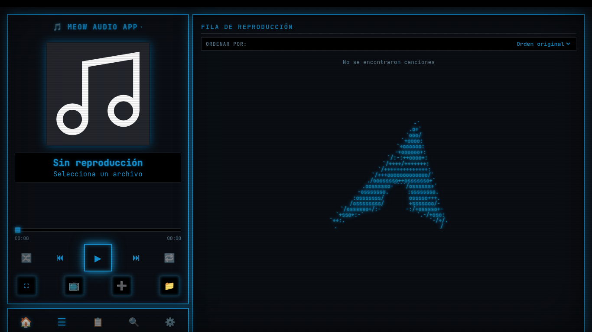

# 🐱 MEOW AUDIO APP PC (v9.5)

**Un reproductor de audio local para escritorio (Linux/Arch) construido con HTML, CSS, JavaScript puro y empaquetado con Electron.**

Meow Audio App es una aplicación de escritorio diseñada para reproducir tu música local con una calidad de interfaz excepcional. No requiere backend, todo el procesamiento de audio es local y tus datos se quedan en tu dispositivo.


*(Sube una captura de la app con el skin de Arch Linux y ponla aquí)*

## ✨ Características Principales (PC)

*   🖥️ **Diseño de Escritorio:** Interfaz adaptada a pantallas grandes con vista de 2 columnas (Reproductor + Fila/Listas).
*   🔍 **Búsqueda Inteligente:** Filtra tu biblioteca en tiempo real por título, artista o álbum usando el botón de la lupa o el atajo `Ctrl + F`.
*   🎵 **Reproducción Local:** Soporte para MP3, WAV, OGG, FLAC, M4A y AAC.
*   🏷️ **Metadatos:** Lectura de ID3 (título, artista, álbum, portada) y specs Hi-Res (FLAC 24bit).
*   🎛️ **Audio Pro:** Ecualizador de 10 bandas, Dolby Spatial Audio, Crossfade, Normalización LUFS y Limitador de picos.
*   🎨 **Sistema de Skins:**
    *   *Classic:* Glassmorphism moderno.
    *   *Consola TUI:* Estética CRT retro con 6 temas de color + editor personalizado.
    *   *@distro_01 y @distro_02:* Inspirados en *fastfetch*, con 26 temas basados en distros de Linux y fondos ASCII gigantes con efecto neón.
    *   *Seasons:* Navidad, Halloween, Cyberpunk y Matrix.
*   ⌨️ **Atajos de Teclado:** Control total sin usar el ratón (`Espacio`, `Flechas`, `N`, `P`, `M`, `F`, etc.).
*   💾 **Privacidad Total:** Persistencia en IndexedDB. Todo es local.

---

## 🚀 Instalación en Arch Linux

Tienes dos formas de instalar la aplicación: usando el paquete pre-compilado (más fácil) o compilando desde el código fuente.

### Opción 1: Instalar el paquete pre-compilado (.pkg.tar.zst)

1. Ve a la sección **[Releases](https://github.com/tu-usuario/Meow-Audio-App-PC/releases)** de este repositorio (o busca el archivo `.pkg.tar.zst` que subimos).
2. Descarga el archivo `meow-audio-app-pc-git-...pkg.tar.zst`.
3. Abre una terminal en la carpeta donde descargaste el archivo y ejecuta:

```bash
sudo pacman -U meow-audio-app-pc-*.pkg.tar.zst
